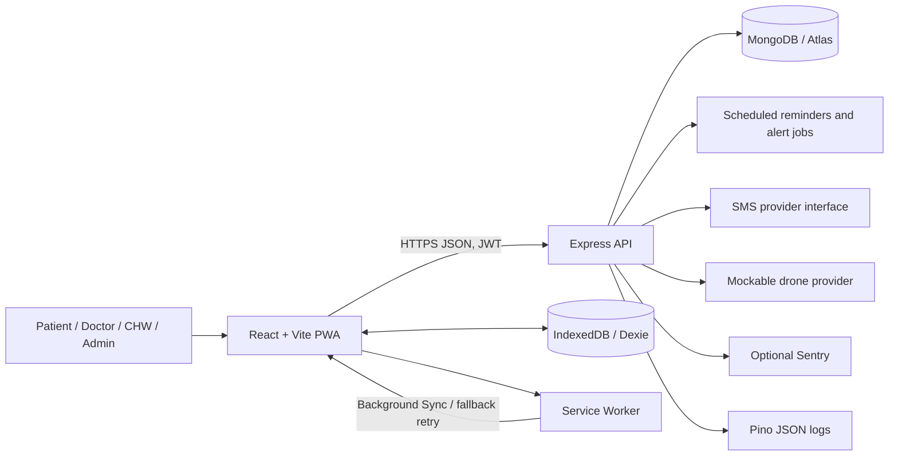

# Chronic Disease Remote Monitoring

A bilingual, mobile-first remote-monitoring PWA for patients living with chronic conditions and the care teams supporting them. Patients and community health workers (CHWs) can record readings; doctors can review risk and alerts; the app supports intermittent connectivity, English and Telugu UI, and an SOS workflow.

> **Important:** This software is not a medical device and does not diagnose, prescribe, or guarantee emergency response. Clinical rules and messages need review by qualified clinicians before real-world use. Use synthetic data during development and testing.

## Screenshots

<!-- Screenshot placeholder: replace with a sanitized patient dashboard capture. -->


<!-- Screenshot placeholder: replace with a sanitized doctor dashboard capture. -->


<!-- Screenshot placeholder: replace with a sanitized Telugu mobile screen capture. -->


## Features

- **Role-based workflows:** Patient, doctor, CHW, and admin accounts with server-enforced access scopes.
- **Readings and alerts:** Record blood pressure, blood sugar, heart rate, weight, and SpO₂; classify readings using configurable rules; view trends and alerts.
- **Care workflows:** Doctor dashboards and patient details, care notes, medication management, appointments, health-centre lookup, and reports.
- **SOS:** Hold-to-confirm SOS, location support, care-team notification workflow, nearest-centre results, and status timeline. Offline requests are queued and can open a pre-filled SMS composer.
- **CHW tools:** Village-scoped patient workflows, assisted readings, visits, alerts, and landing-point verification.
- **English and Telugu:** Localized UI, date/number formatting, persisted language selection, and server-side message templates.
- **Offline-first PWA:** IndexedDB queues for supported forms, retry/backoff synchronization, cached data, installable app shell, and sync status.
- **Operational integrations:** SMS provider interface and mockable drone mission provider. Real aircraft operations are not provided.
- **Security controls:** JWT access tokens and rotated refresh cookies, RBAC, validation, request limits, audit events, encrypted emergency contacts, Pino structured logs, and optional Sentry.

## Architecture



The client, API, and database are separate concerns. In the same-host production deployment, Nginx serves the SPA and reverse-proxies `/api` to the API container; the API connects to MongoDB Atlas. See [deployment guide](docs/deployment.md) for other hosting options and topology details.

## Tech stack

| Area | Technologies |
|---|---|
| Web client | React, Vite, React Router, Tailwind CSS, Axios, React Hook Form, Recharts |
| Localization and offline | react-i18next, English/Telugu JSON locales, PWA service worker, Dexie / IndexedDB |
| API | Node.js, Express, Mongoose, Zod, JWT, bcrypt |
| Security and operations | Helmet, CORS allowlist, rate limiting, request sanitization, Pino, optional Sentry |
| Database | MongoDB; MongoDB Memory Server for API tests |
| Testing | Jest, Supertest, Vitest, React Testing Library, fake-indexeddb, Playwright |
| Deployment | Docker, Nginx, Docker Compose, GitHub Actions |

## Requirements

- Node.js **20.19+** (Node 22 is used in CI) and npm.
- MongoDB local instance or a MongoDB Atlas database.
- Optional for container-based setup: Docker Engine and the Docker Compose plugin.

## Local setup

Run the API and client in separate terminals from the repository root.

### 1. Configure MongoDB

Use an existing local MongoDB instance or start the development database with the repository Compose file. For the Compose option, create a root `.env` file from `.env.compose.example`, replace both placeholder passwords with long local-only values, then start MongoDB:

```sh
cp .env.compose.example .env
docker compose up -d mongo
```

On Windows PowerShell, use `Copy-Item .env.compose.example .env`, then edit `.env`.

The local connection URI for that Compose service is:

```text
mongodb://chronic_local_admin:<URL-encoded-MONGO_ROOT_PASSWORD>@127.0.0.1:27017/chronic-care?authSource=admin
```

For an existing local server, use its own connection URI. Do not expose MongoDB or mongo-express to the public internet.

### 2. Configure and start the server

```sh
cd server
npm ci
cp .env.example .env
```

On Windows PowerShell, use `Copy-Item .env.example .env`. Edit `server/.env`:

- Set `MONGO_URI` to the MongoDB URI above (URL-encode special characters in credentials).
- Set `JWT_ACCESS_SECRET` and `JWT_REFRESH_SECRET` to distinct random values.
- Set `SEED_PASSWORD` to a local-only password of at least 12 characters. This same password will be assigned to all seeded demo accounts.
- Leave `NODE_ENV=development`, `COOKIE_SECURE=false`, `SMS_PROVIDER=mock`, and `DRONE_PROVIDER=mock` for local development.
- `PII_ENCRYPTION_KEY` can remain empty for a fresh local database; generate and preserve a 32-byte base64 key if exercising encrypted emergency contacts.

Start the API:

```sh
npm run dev
```

The API listens on `http://localhost:5000`; health check: [`/api/health`](http://localhost:5000/api/health).

### 3. Seed synthetic demo accounts

In another terminal:

```sh
cd server
npm run seed
```

The seed requires `SEED_PASSWORD` in `server/.env` and refuses to run when `NODE_ENV=production`. It upserts synthetic users, patients, staff, health centres, and inactive illustrative landing points. Running it again resets the seeded accounts' passwords to the configured `SEED_PASSWORD`; do not run it against production data.

#### Demo logins

All accounts use the `SEED_PASSWORD` value configured in `server/.env`.

| Role | Phone |
|---|---|
| Admin | `9000000001` |
| Doctor | `9000000002` or `9000000003` |
| CHW | `9000000004` or `9000000005` |
| Patient | `9000000006` through `9000000010` |

These are development-only synthetic accounts. Change the seed password before use and never deploy seed credentials.

### 4. Configure and start the client

```sh
cd client
npm ci
cp .env.example .env
npm run dev
```

On Windows PowerShell, use `Copy-Item .env.example .env`. The local example sets `VITE_API_BASE_URL=http://localhost:5000/api`. Open the Vite URL shown in the terminal (usually `http://localhost:5173`).

To test the production-built SPA/PWA locally:

```sh
npm run build
npm run preview
```

## API summary

All routes use the `/api` base path. The API includes authentication, patients and assignments, readings and series, dashboards, alerts, offline sync, CHW visits and performance, SOS, appointments, medications/notes, health centres, landing points/drone missions, SMS, reports, audit, and health-check modules.

See [docs/api.md](docs/api.md) for the schema and endpoint contract, role access, request/response shapes, and implementation status. Check its implementation notes before relying on endpoints described as proposed or Phase 2.

Health check: `GET /api/health`. Responses use JSON with a consistent `success`, `message`, and `data` or `error` envelope.

## Offline and PWA notes

- The app shell is precached by the service worker; supported GET requests use runtime caching.
- Supported reading, patient, visit, and SOS workflows can queue work locally with client-generated IDs. The sync manager retries batches when connectivity returns, with a fallback timer when Background Sync is unavailable.
- Sync status is visible in the app. A locally queued SOS is **not** a server-confirmed alert; the interface can open the device SMS composer as a fallback.
- IndexedDB is stored on the device and is not a secure substitute for server authorization or a server backup. Avoid shared-device deployments without an appropriate device/session policy.
- PWA installation requires a supported browser and secure context (HTTPS in deployment; localhost is treated as secure for development). Offline behavior varies by browser and operating system; verify critical workflows on target devices.

## SMS command reference

Incoming SMS commands use these ASCII command keywords (case-insensitive); the patient's registered sender phone identifies the account. A response is localized to the user's language preference. Telugu users should send the same command format using Latin command names and digits; Telugu script commands are not parsed.

| Measurement | Command | Example |
|---|---|---|
| Blood pressure | `BP <systolic> <diastolic>` | `BP 140 90` |
| Blood sugar | `SUGAR <value> <F\|P\|R>` | `SUGAR 180 F` |
| Heart rate | `HR <value>` | `HR 88` |
| SOS | `SOS` | `SOS` |

Sugar context: `F` means fasting, `P` means post-meal, and `R` means random. `SUGAR 180` without a context defaults to random. Common alternatives such as `BP 140/90`, `HEART RATE 88`, and `PULSE 88` are accepted. Malformed or out-of-range inputs receive an error response; provider signature verification and inbound rate limits are required for production SMS webhooks. See the SMS section in [docs/api.md](docs/api.md).

Do not use SMS as an emergency-service guarantee. For immediate danger, use local emergency services (India: **108**) directly.

## Drone module disclaimer

Drone missions are a mockable software workflow for requesting, reviewing, and tracking a simulated supply delivery. The included mock provider does not operate aircraft. Flight planning, dispatch, aircraft control, payload release, and regulatory authorization are explicitly out of scope. Real-world operations require DGCA and other applicable approvals, certified operators, safety assessment, weather/no-fly controls, and operational procedures. Do not connect a real provider without legal, safety, and clinical approval.

## Testing and quality checks

From `server/`:

```sh
npm run lint
npm test
npm run test:coverage
```

From `client/`:

```sh
npm run lint
npm test
npm run test:coverage
npm run translations:check
npm run build
```

Browser tests need a reachable test MongoDB, a test-only `SEED_PASSWORD`, and the required test JWT/PII environment variables:

```sh
npm run test:e2e
```

Playwright starts the API and built-client preview and seeds synthetic accounts. Install its browser once with `npx playwright install chromium`. Never point E2E tests at production. See [docs/test-plan.md](docs/test-plan.md) for role-based, low-network, offline, Telugu, accessibility, and emergency mock test cases. GitHub Actions runs lint, tests, coverage, build, translations, and E2E before publishing production images.

## Deployment

See [docs/deployment.md](docs/deployment.md) for Dockerfiles, production Compose, Atlas networking and daily backups, environment variable requirements, Render/Railway/Vercel/Netlify options, EC2 with Nginx and Let's Encrypt, logging, Sentry, uptime checks, CI/CD, and rollback.

Production requires real secrets, `COOKIE_SECURE=true`, HTTPS, exact CORS origins, an Atlas least-privilege user and network allowlist, a preserved PII encryption key, verified SMS webhooks, and monitored backups. Do not copy development defaults to production.

## Roadmap

This is a project codebase, not a declaration of clinical or regulatory readiness. Potential next steps:

- Complete clinical/privacy/security review and define approved thresholds, consent, data retention, incident response, and support operations.
- Validate production deployment, accessibility, Telugu translations, low-end devices, and low-connectivity behavior with representative users.
- Complete operational monitoring, tested restore drills, release approvals, and provider onboarding.
- Evaluate future integrations such as validated device ingestion, push delivery, medication adherence, and advanced analytics only after requirements and safety review.
- Keep drone support in simulation until separately authorized and operationally validated.

## Contributing

1. Open an issue describing the change, user impact, and test plan; avoid real or identifiable health information.
2. Work on a focused branch and follow existing patterns, validation, role boundaries, and localization conventions. Add or update tests and relevant docs.
3. Run the applicable server/client lint, tests, coverage, translation check, and build commands above.
4. Submit a pull request with scope, test results, configuration/migration notes, and risks. Do not include credentials, production records, real phone numbers, or unsanitized screenshots.

Changes to clinical thresholds, emergency messages, consent, data retention, or external-provider behavior require the appropriate clinical/privacy/safety review before release.

## License

No `LICENSE` file is currently included. Until a license is selected and added by the repository owner, no open-source license is granted; do not assume permission to redistribute or use this project beyond rights otherwise applicable.
